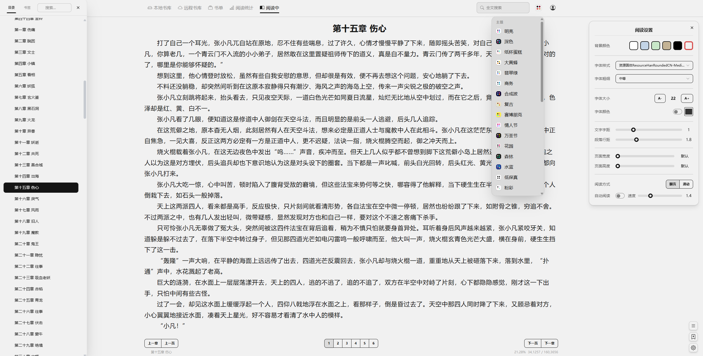
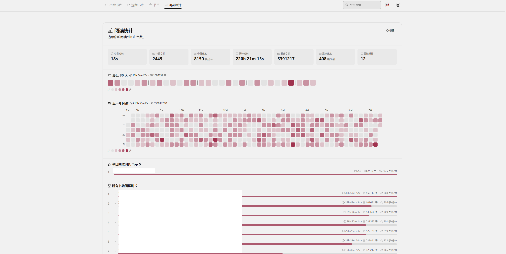
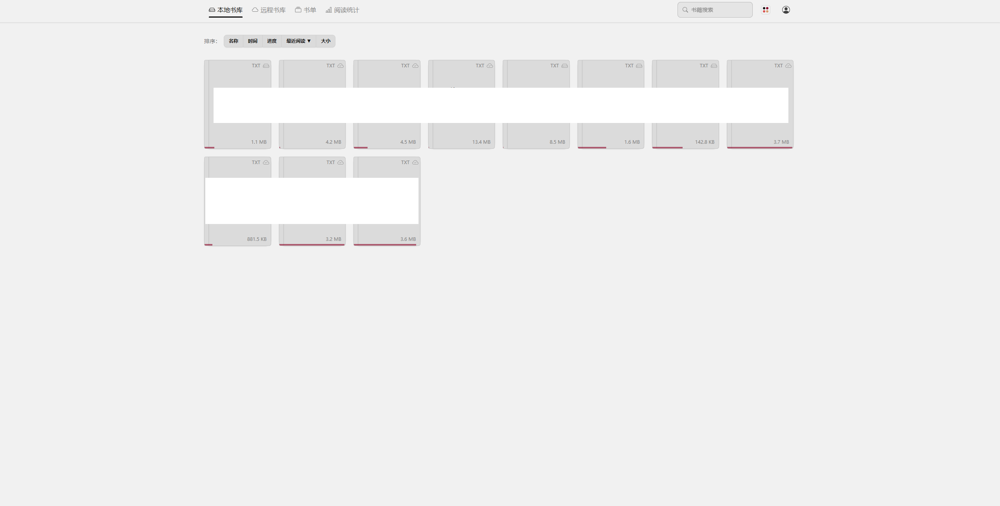
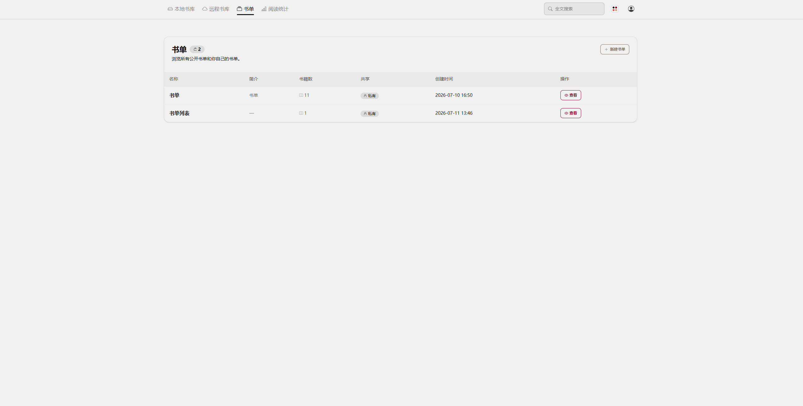

# Reader-Reeden

基于 Django 的 Web 在线阅读器，支持本地/S3 书籍、自动分章、多端进度同步。

**支持与 Reeden 通过 S3 双向同步阅读进度。** 个人项目，与 Reeden 无任何关系。

**内置 KOReader KoSync Server。** 支持通过 KoSync 与外部 KOReader 设备或 Reeden 同步阅读进度

Reeden 的 通过koreader 同步功能对于txt格式的支持有问题，暂不建议使用

## 预览

| 阅读 | 统计 |
|---------|---------|
|  |  |

| 书库 | 书单 |
|---------|---------|
|  |  |


## 功能

### 书籍管理

- **本地书库** — 网格卡片，封面+书名+进度，按名称/时间/进度/最近阅读排序，实时搜索
- **远程书库** — 浏览 S3 中 `.txt` / `.epub` 文件，一键下载导入
- **书籍管理** — 表格管理（字数、章节、进度、共享、时间），支持重新分章、共享切换、删除
- **分卷目录** — TXT 书籍可为每条分章规则配置配套分卷规则，目录按「卷 → 章」两级展示；卷标题不计入章节数量
- **书单管理** — 创建书单，从书库/远程书库添加或手动录入外部书籍；书籍入库后自动关联本人书单中的同名外部条目
- **书签管理** — 跨书籍浏览全部书签，支持删除
- **书籍上传** — 拖拽上传 `.txt` / `.epub`，单文件最大 100MB；TXT 自动检测编码分章，EPUB 提取书名作者并按原书目录阅读
- **权限** — 私有书籍仅上传者与超管可见；管理操作仅限上传者或超管；用户数据按目录隔离

### 阅读体验

- **翻页模式** — CSS 多栏横向翻页，键盘 ←→ 翻页、↑↓ 翻章，页码省略号自适应屏宽
- **滑动模式** — 连续纵向滚动，章节自动拼接，滚至顶/底自动加载上下章
- **自动阅读** — 速度滑块 0.1~10 px/帧，手动滚动暂停后恢复，末尾自动停止
- **全文搜索** — 模态框展示命中行，点击跳转
- **章节预加载** — 预加载前后 10 章到内存，切章无刷新
- **阅读设置** — 字号、字体、颜色、粗细、字距、行距；5 种背景主题；设置服务端持久化

### 进度同步

- **S3 旧进度自动纠正（可选，默认关闭）** — 监听 OpenList 本地进度目录，在满足规则时回写服务器进度；需独立运行监听进程，见[部署与规则说明](docs/s3-progress-correction.md)。

- 滚动/翻页自动保存（防抖 500ms）
- 打开书籍时比较本地文件 / 数据库 / S3 三方时间戳，取最新进度
- 重新分章时进度按百分比自动映射，并同时按当前分章规则及配套分卷规则重建卷信息
- 分卷只影响目录与同步索引，内部章节索引保持不变；EPUB 不使用 TXT 分卷规则
- 纯本地上传书籍仅存 DB，不同步 S3
- **内置 KOReader KoSync Server**：外部 KOReader 设备与 Reader-Reeden 可共用同一套阅读进度；支持 Binary / Filename 两种书籍匹配方式
- EPUB 支持 S3 进度同步，会记录章节和段落位置；打开书籍本身不会立即覆盖云端进度

### EPUB 阅读

- 支持无 DRM 的 EPUB 2/3。导入后会自动读取书名、作者和原书目录，默认按原书排版阅读，不需要手动分章。
- 支持原书排版模式：尽量保留原书的字体、图片、表格和样式，适合图文混排的书。
- 支持纯文本模式：只提取正文，沿用 TXT 的阅读界面和设置，适合只想看文字。


### 阅读统计

- 今日/累计阅读时长与字数
- 近 30 天与近一年热力图
- 书籍阅读时长排行

### 用户系统

- 首次运行引导创建超级管理员
- 个人设置：云端存储配置、分章规则（主规则 + 2 条备用，每条可配套分卷规则）、阅读进度同步方式、KoSync 认证、修改密码

### 字体管理

- 浏览云端字体库，一键下载
- 本地字体表格管理，阅读界面加载更换

### 界面

- DaisyUI 5 + Tailwind 4，卡片式管理页面，统一视觉风格
- 35 种主题可切换，设置实时生效

## 快速开始

```bash
pip install -r requirements.txt
cd Reader-Reeden
python manage.py migrate
python manage.py runserver
```

访问 `http://127.0.0.1:8000/`，首次自动跳转 `/setup/` 创建管理员。

## Docker 部署

镜像 `ting1e/reader-reeden` 支持多架构（amd64 + arm64）。

### 拉取并运行

```bash
docker compose up -d
```

访问 `http://localhost:8000/`，数据持久化在 `./local/`。

### docker-compose.yml

```yaml
services:
  reader:
    image: ting1e/reader-reeden:latest
    container_name: reader-reeden
    ports:
      - "8000:8000"
    volumes:
      - ./local:/app/local
    environment:
      DJANGO_DEBUG: "False"
      DJANGO_ALLOWED_HOSTS: "*"
      DJANGO_CSRF_TRUSTED_ORIGINS: ""
    restart: unless-stopped
```

### 环境变量

| 变量 | 默认 | 说明 |
|------|------|------|
| `DJANGO_DEBUG` | `False` | DEBUG 模式 |
| `DJANGO_ALLOWED_HOSTS` | `*` | 允许的 Host，逗号分隔 |
| `DJANGO_CSRF_TRUSTED_ORIGINS` | 空 | CSRF 信任来源，HTTPS 域名访问时需填 |
| `DJANGO_SECRET_KEY` | 空 | 优先于 `local/secret_key.txt`；均未设置时首次运行自动生成 |

### 数据持久化

`./local/` 挂载到 `/app/local`：

```
local/
├── db.sqlite3              # 数据库
├── secret_key.txt          # SECRET_KEY
├── .device_id              # 本机设备 ID（进度同步）
├── logs/                   # 日志
└── {user_id}/              # 按用户隔离
    ├── books/              # S3 下载书籍
    ├── upload/             # 本地上传书籍
    ├── book_progress/      # 进度 JSON
    └── fonts/              # 字体文件
```

## 手动部署

通过环境变量覆盖（见上表），或修改 `mysite/settings.py`：

```python
DEBUG = False
ALLOWED_HOSTS = ['your-domain.com']
CSRF_TRUSTED_ORIGINS = ['https://your-domain.com']
```

## S3 配置

个人设置中配置（JSON）：

```json
{
  "accessKeyId": "YOUR_ACCESS_KEY",
  "secretAccessKey": "YOUR_SECRET_KEY",
  "region": "",
  "endpoint": "https://s3.youcloud.com",
  "bucket": "YOUR_BUCKET_NAME",
  "prefix": "Reeden DIR"
}
```

- 远程书库：`{prefix}/books/`
- 字体库：`{prefix}/fonts/`
- 进度同步：`{prefix}/book_progress/{md5}.json`

## KOReader KoSync Server

Reader-Reeden 内置兼容 KOReader KoSync v1 的同步服务，路由直接挂载在站点根路径：

| 方法 | 路径 | 说明 |
|------|------|------|
| GET | `/healthcheck` | 服务状态 |
| GET | `/users/auth` | 账号认证（`x-auth-user` + `x-auth-key`） |
| POST | `/users/create` | 注册关闭，返回 402 |
| PUT | `/syncs/progress` | 上传进度 |
| GET | `/syncs/progress/{document}` | 获取进度 |

- 在 Django Admin 的「系统设置」中开启 `kosync_enabled`，默认关闭。
- 个人设置中先用当前账号密码初始化 KoSync 认证，再选择「KoSync 同步」。
- KOReader 的服务器地址填写站点根地址，例如 `https://reader.example.com/`。
- `x-auth-key` 为账号密码的 MD5；服务端只保存该值的 Django 安全哈希。
- 书籍匹配方式需与 KOReader 设备保持一致：Binary（默认）或 Filename。

## 进度文件格式

与 Reeden 兼容的 `{md5}.json`：

```json
{
  "schemaVersion": 1,
  "bookId": "文件MD5（大写）",
  "sectionIndex": 0,
  "paragraphIndex": 0,
  "elementIndex": 0,
  "readProgress": 0,
  "lastReadTime": "2024-01-01T00:00:00.000Z",
  "deviceId": "MAC地址UUID",
  "todayStats": { "date": "2024-01-01", "devices": {} }
}
```

| 字段 | 说明 |
|------|------|
| `sectionIndex` | 章节索引；有分卷时始终为「卷 + 章」混合索引 |
| `readProgress` | 进度 0~10000（99.99% 精度） |
| `paragraphIndex` / `elementIndex` | 段落索引 / 段内偏移（CJK 计 2） |
| `lastReadTime` | ISO 8601 UTC 时间戳 |

本地进度文件始终保存内部章节索引；上传到 S3 时统一转换为「卷 + 章」混合索引，卷标题占一个位置，恢复时定位到该卷第一章。没有分卷的书籍索引保持不变。

`sectionIndex` 始终按「卷 + 章」混合索引解释，不再写入或依赖版本标记；旧数据不做额外章节迁移。

## 目录结构

```
Reader-Reeden/
├── Dockerfile
├── docker-compose.yml
├── entrypoint.sh           # 建目录 + migrate
├── local/                  # 运行时数据（结构见「数据持久化」）
├── reader/
│   ├── templates/
│   ├── static/
│   ├── models.py
│   ├── views/              # auth/books/reader/bookmark/booklist/settings/fonts/setup/stats
│   ├── services/           # book_parser/progress/s3/volume
│   ├── middleware.py       # 首次运行检测
│   ├── ratelimit.py
│   └── utils.py
├── mysite/
└── requirements.txt
```
